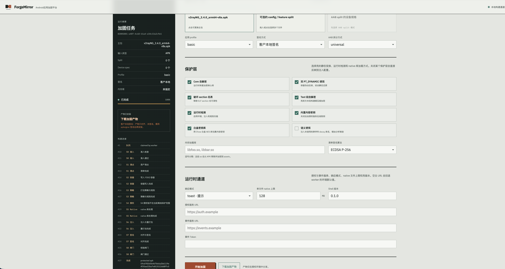
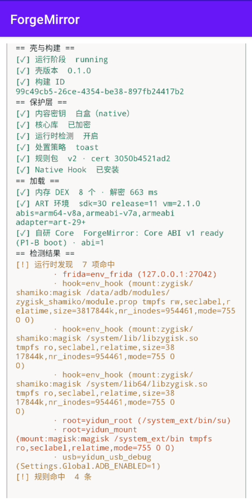

# 铸镜 ForgeMirror

是我在 Android 逆向过程中遇到的商业加固核心功能的等价实现，用来研究各种防护和绕过技术

## 项目结构

- frontend/src：Web 界面，应用上传、加固配置、任务状态、产物下载和研究结果展示。
- backend/cmd、backend/internal、backend/pipeline、backend/tests：Go/Gin API、PostgreSQL/pgx 存储、Python 加固流水线与测试。
- android/app：Studio 标准 Android 工程；src/main/java 为 Java，src/main/cpp 为原生代码，src/test 与 src/androidTest 为测试。
- android/shield：运行时加固库（Java + C++17），含内存 ELF/DEX 加载、Hook 后端、PKR1 规则、检测与事件。
- docs：设计、实现原则、开发环境、格式、证据和 research 研究资料。

根 artifacts/ 按需产生并由 Git 忽略；研究样本的 dump、伪代码和等价代码留在外部目录。

## 当前状态

- Android：容器 v2、内存 DEX/ELF 加载、动态 TLS、native 白盒内容密钥与容器解密、Dobby（x86_64）/ShadowHook（arm/arm64）后端、16 KB 页、透明文件保护、PKR1 规则包、运行时检测与事件队列均已实现并有设备/主机证据。
- 检测：通用 `env_*` 规则 + 易盾来源的 `yidun_*` 规则；签名特征可随 PKR1 下发并在下次进程启动生效，已实测 v2→v3→v4 远程更新、篡改拒绝和版本门控。
- 后端：Go API、PostgreSQL、认证/事件/规则/配置接口已实现；PKR1 上传与版本门控可用。
- 流水线：S0–S8、APK/AAB、universal/default split、多 device-spec 批量、容器/策略/规则/清单、16 KB 对齐与 S8 闸门均有测试覆盖。
- 前端：上传/加固选项/任务进度/产物下载/安全事件页面已实现，已与 API/worker 联调。

## 保护层（7 个核心功能）

前四层让静态分析拿不到完整信息，后三层让密钥和运行环境更难被直接定位。Web 界面与 CLI 均有对应开关。

| 保护层 | 说明 |
|---|---|
| Core 自解密 | 核心 so 不在 APK 里明文存在，启动时才解密到内存 |
| 双 PT_DYNAMIC 诱饵 | 动态链接表放一份精简假表，真表字节仍留在文件里 |
| 破坏 section 名表 | 抹掉 ELF 段名字，静态工具看不到 `.text` 等提示 |
| Text 段自解密 | 壳自己的代码段先压缩加密，启动时才解开执行 |
| 运行时检测 | App 跑起来后检查环境、注入和规则，命中就记录或处置 |
| 内置内容密钥 | 解密业务代码的钥匙随包分发，但按用途拆成多把 |
| 白盒密钥库 | 钥匙不直接存，用按构建随机生成的白盒表包住，运行时在 native 里拆开 |

1. **Core 自解密**：核心库以密文形式随包，运行时才解密加载。
   - 构建期把 `libshield_core.so` 用 HKDF(`FM/core/v1`) + AES-GCM 封装为 `assets/shield/core/<abi>.enc`，并从 APK 移除明文 core
   - 运行时按 ABI 选取加密 core，解密后写入 memfd
   - `android_dlopen_ext` + 自研 ELF loader 直接从 fd 映射，不落盘
   - 映射完成后关闭 fd；core 缺失时回退平台库并记录降级
2. **双 PT_DYNAMIC 诱饵**：动态链接信息给静态工具看假的，真表仍藏在文件里。
   - 追加精简伪动态表，仅保留 `DT_NEEDED`、`DT_SONAME`、`DT_STRTAB`、`DT_STRSZ`、`DT_NULL`
   - `PT_DYNAMIC` 与 `SHT_DYNAMIC` 同步指向伪表，原始动态表字节保留，形成真伪双表
   - 可叠加 section 名表破坏；按伪表还原会丢失符号与重定位信息
   - core 库不做该变换，保证自解密链路完整
3. **破坏 section 名表**：ELF 段名字被抹掉，干扰静态工具分析。
   - 构建期覆写 ELF `shstrtab`，section 名不可读
   - 保留 program header、`.dynamic`、`.dynsym` / `.dynstr` 与重定位结构
   - 与双 PT_DYNAMIC 同开关生效，覆盖 boot / hook / yara 等壳库
   - 16 KB 页对齐与签名流程不变
4. **Text 段自解密**：壳的代码段平时是密文，运行到它时才解开执行。
   - 对 boot / hook / yara 的 `.text` 做 LZSS 压缩 + 32 字节密钥异或
   - 压缩密文追加到文件尾部，并重建 section header
   - `DT_INIT`（`fm_selfdecrypt_init`）在加载前解密并 `mprotect` 恢复执行权限
   - 逐库记录压缩前后大小；不支持的 ELF 自动跳过并告警
5. **运行时检测**：App 启动后持续检查是不是被 Root、注入或改包，并按策略处置。
   - 通用 `env_*` 规则 + 易盾来源的 `yidun_*` 签名
   - native YARA 扫描 DEX / ELF / 字符串 / 哈希，命中写入事件队列
   - PKR1 签名规则包，支持远程下发、版本门控与篡改拒绝
   - 响应模式 `log` / `toast` / `degrade` / `block`
   - 事件由主进程统一上报 API
6. **内置内容密钥**：解密业务代码的钥匙随包走，但拆成多个、各管一层。
   - 32 字节 `K_content` 随包分发；也可复用已有 key file 保证可复现构建
   - native vault 安装后按标签派生 policy / file / native / rules / core 密钥
   - 关闭“内置内容密钥”后改为授权服务在线取钥，根密钥只安装一次
   - 密钥资产纳入签名清单与产物校验
7. **白盒密钥库**：钥匙不裸存，先用白盒表包起来，运行时在 native 里拆。
   - 每次构建用随机密钥生成一张全新的 Chow 白盒表（约 0.5 s，`--no-whitebox-random-table` 回退固定表）
   - 构建期生成 `WBK1` 包裹块（nonce + Chow 白盒 CTR keystream）
   - 保护时导出 `WBX1` 扁平表（约 1.2 MB），Java 白盒实现只留在构建工具
   - native C 实现白盒查表、HKDF、FDX2 AES-GCM 解密与逐文件 SHA-256 校验
   - 根密钥不回到 Java；Java 只持有派生密钥，用完清零
   - 表格式、长度与魔数严格校验，解包失败直接 fail-closed
## 实验性：语义诱饵用来反AI分析

默认关闭，用于研究 AI/自动化分析噪音，不属于上面的 7 个核心保护层。

- 词表驱动：默认词表覆盖网络安全与中性学科（生命科学、材料、法务/财务、生物、化学等等），可用 `--ai-decoy-lexicon` 替换
- 构建期 `javac --release 11` 生成未使用的 decoy 类，合并进 `classes.jar` 后随 stub DEX 打包
- 类仅包含静态字符串和 getter，运行时不引用、不加载，App 行为不变
- 开关贯通 CLI / API / worker / Web 界面，默认关闭
- 不保证任何模型终止分析；可能引起应用商店或 EDR 误报，仅在研究场景开启



## 技术选型

Vue 3 + TypeScript + Vite；Go + Gin + PostgreSQL/pgx；Python worker 与流水线；Android Java + C++17。详见 [架构选型](docs/架构选型.md)。

## 常用验证

```bash
# Android 单元测试
cd android && ./gradlew :shield:testDebugUnitTest

# 设备测试（示例：易盾探针）
ANDROID_SERIAL=<serial> ./gradlew :app:connectedDebugAndroidTest \
  -Pandroid.testInstrumentationRunnerArguments.class=dev.forgemirror.demo.YidunProbeDeviceTest

# 后端 + 流水线全量检查
backend/pipeline/scripts/check.sh
```

## 文档

- [独立实现原则](docs/实现原则.md)
- [设计文档](docs/设计文档.md)
- [研究证据：参照样本 A（梆梆 libDexHelper）](docs/research/libDexHelper_架构还原.md)
- [研究证据：参照样本 B（网易易盾 libnesec）](docs/research/libnesec_易盾加固还原.md)
  - [检测链路实测](docs/research/libnesec_检测实测.md)、[证书链分析](docs/research/libnesec_证书链分析.md)、[VM 还原](docs/research/libnesec_VM还原.md)、[函数分类](docs/research/libnesec_函数分类.md)
- [规则包格式](docs/formats/rules-v1.md)
- [16 KB 页适配](docs/evidence/2026-11-21-P2-16kb.md)
- [split APK / AAB](docs/evidence/2026-11-21-P2-split-aab.md)
- [自研 loader 动态 TLS](docs/evidence/2026-11-21-P2-tls-relocation.md)
- [白盒化内容密钥](docs/evidence/2026-11-21-P2-whitebox-key.md)
- [x86_64 hook 与 API 37](docs/evidence/2026-11-14-P1-api37-hooks.md)
- [前端加固选项](docs/evidence/2026-11-21-P2-ui-hardening-options.md)
- [开发环境](docs/开发环境.md)
- [依赖登记](docs/components.lock.json)

研究文档中的旧相对路径以 `<external-research-dir>/reference-a` 和 `<external-research-dir>/sampleb` 为准。原目录说明归档在 docs/初始目录说明归档.md，仅作历史资料。
